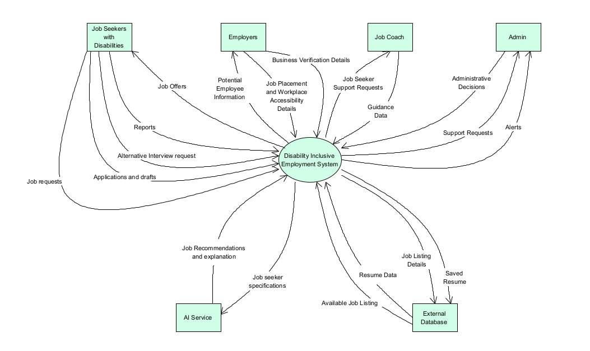
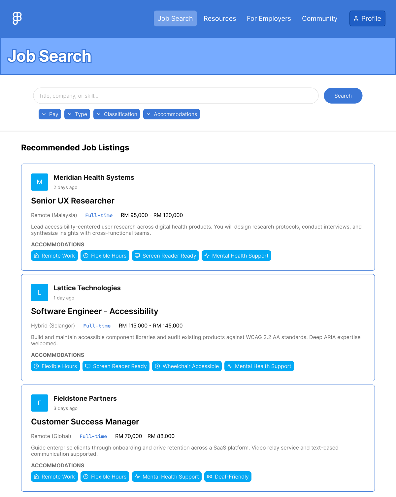
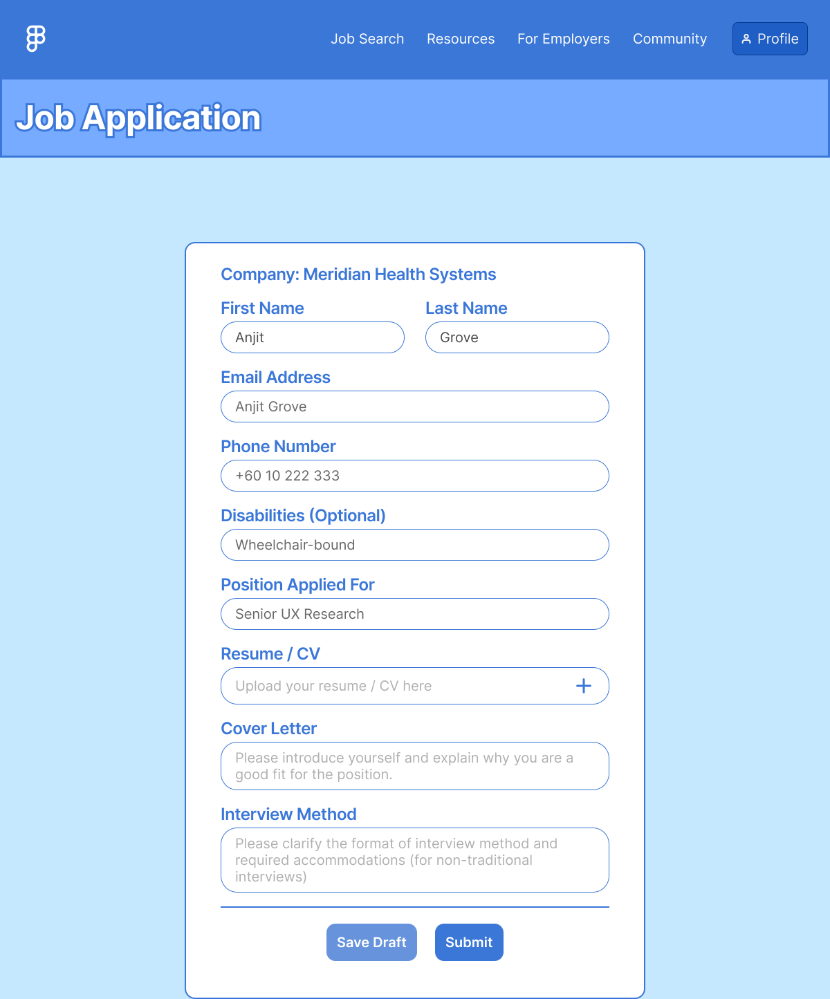
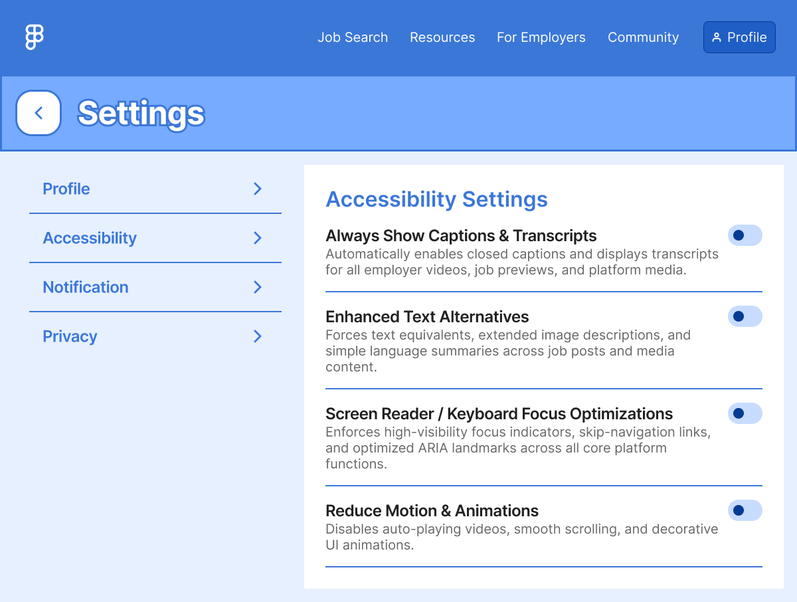
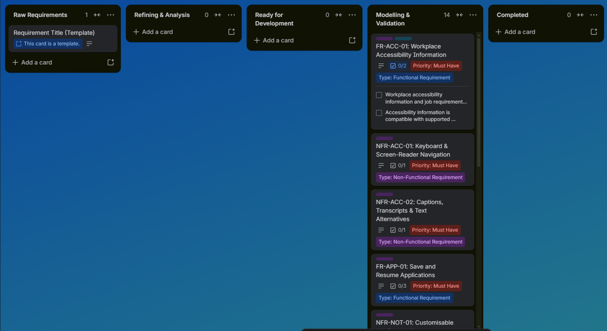

# Inclusive Employment Platform: Requirements Engineering Case Study

This is a requirements specification for a job platform that helps people with disabilities find accessible work. It takes the problem from stakeholder analysis through to a prioritised, traceable set of requirements and testable user stories.

**[▶ Clickable prototype (Figma)](https://www.figma.com/proto/nz0ZIP3GQxjqwamWodeeaO/Job-Searching-App?node-id=6036-164056)** · **[Full report (PDF)](docs/Final-Report.pdf)** · **[Traceability matrix](docs/traceability-matrix.md)**

> Group coursework (4 members) for a Requirements Engineering module, 2026. The interviews and survey were **simulated**.

---

## The problem

Job seekers with disabilities often can't tell whether a workplace is accessible before applying. They also feel pressured to disclose their disability, struggle with complex application forms, and are targeted by fake employers. The goal was to specify a platform that is **fair, accessible and privacy-respecting** for job seekers, while staying **practical for employers** to use.

## At a glance

| 9 | 10 | 15 | 11 | 10 |
|:-:|:-:|:-:|:-:|:-:|
| stakeholder groups | risks assessed | requirements | conflicts resolved | user stories |

## Process

| Stage | What was done | Output |
|---|---|---|
| **1. Stakeholder analysis** | Mapped 9 stakeholder groups and rated 10 ethical risks by likelihood and impact | [Stakeholders & risks](docs/stakeholder-analysis.md) |
| **2. Elicitation** | Simulated interviews and a survey across 6 user groups, cross-referenced for confidence | [Elicitation](elicitation/) |
| **3. Analysis** | Classified functional and non-functional requirements, prioritised with MoSCoW, identified conflicts | [Requirements](docs/requirements-catalogue.md) · [Conflicts](docs/conflict-analysis.md) |
| **4. Modelling** | System context diagram; user stories with Given/When/Then criteria and INVEST checks | [User stories](docs/user-stories.md) |
| **5. Validation** | Requirements walkthrough and prototype review; 3 requirements renegotiated with employers | [Negotiation outcomes](docs/conflict-analysis.md#negotiation-outcomes) |

---

## Highlights

### System context

How the platform interacts with job seekers, employers, job coaches, admins and external services.



### Every requirement traces back to evidence

| Requirement | Evidence | Stakeholder need | User story |
|---|---|---|---|
| **FR-ACC-01**: show verified workplace-accessibility info before applying | Interview INT-01, Survey SF-01 | N01 | US-01 |
| **FR-PRIV-01**: never require disability disclosure at registration or initial application | INT-01, SF-04 | N06 | US-08 |
| **FR-MATCH-01**: recommend jobs on skills and preferences, not disability | INT-03, SF-05 | N07 | US-03 |
| **FR-EMP-01**: auto-verify employers via email domain and business registry | INT-03, SF-10 | N12 | US-06 |

→ [Full traceability matrix](docs/traceability-matrix.md) (all 15 requirements)

### Trade-offs made explicit

| Conflict | Tension | Resolution |
|---|---|---|
| Better matching vs. disability privacy | Personalisation vs. privacy | Match on skills; disclosure always optional |
| Employer verification vs. sign-up effort | Trust vs. participation cost | Automated domain and registry check instead of manual audits |
| Moderating reports vs. running costs | Safety vs. cost | Automated flagging prioritises; a human always decides |

→ [All 11 conflicts and how they were resolved](docs/conflict-analysis.md)

### Testable user stories

> **US-03:** As a **job seeker**, I want job recommendations driven by my skills, with clear explanations, so that I am matched fairly and understand the system's logic.
>
> - **Given** the system generates recommendations, **when** the matching runs, **then** it uses skills, qualifications and preferences, and does not use disability as a primary screening factor.
> - **Given** a recommended job is shown, **when** the job seeker views it, **then** a plain-language explanation of the match is displayed.

### Prototype

Key requirements, shown in the clickable prototype:

| Job search | Job application | Accessibility settings |
|:-:|:-:|:-:|
|  |  |  |
| Accommodation tags on every listing (FR-ACC-01); recommended listings (FR-MATCH-01) | Optional disability field (FR-PRIV-01); interview method (FR-INT-01); Save Draft (FR-APP-01) | Captions, text alternatives and keyboard/screen-reader options (NFR-ACC-01, NFR-ACC-02) |

**[▶ Try the clickable prototype in Figma](https://www.figma.com/proto/nz0ZIP3GQxjqwamWodeeaO/Job-Searching-App?node-id=6036-164056)**

### Requirements managed as a backlog

Each requirement was tracked as a Trello card with its priority, type, sustainability flags and acceptance criteria.



---

## What I'd improve

- **Validate with real stakeholders.** All elicitation was simulated, and three user groups were covered by the survey only.
- **Make non-functional requirements measurable.** For example, set NFR-ACC-01 to a WCAG 2.2 AA target and give NFR-SEC-01 a defined retention period, so they can be tested objectively.
- **Close the story gap.** FR-EMP-03 was added during negotiation and still needs its own user story.
- **Keep IDs consistent across tools.** The report's requirement IDs were cleaned up after submission, but the Trello screenshots still show the earlier ones (e.g. NFR-NOT-01, now FR-NOT-01).

## Repository structure

```
├── docs/
│   ├── stakeholder-analysis.md     Stakeholder register and ethical risk register
│   ├── requirements-catalogue.md   Final functional and non-functional requirements
│   ├── traceability-matrix.md      Evidence → need → requirement → user story
│   ├── user-stories.md             10 user stories with acceptance criteria
│   ├── conflict-analysis.md        11 conflicts, resolutions and negotiation outcomes
│   └── Final-Report.pdf            Full group report
├── elicitation/                    Simulated interview transcripts and survey data
└── images/                         Diagram, prototype and Trello screenshots
```

## Team

Choong Wan Jun · Hooi Ming Han · Tey Tiong Sheng · Yap Jin Ming
